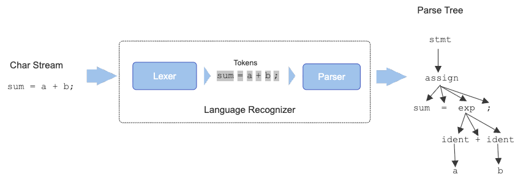

# Lex-Engine


[](https://www.java.com/)
[](LICENSE)

**Lex-Engine** is a Java language recognizer with a lexical analyser and parser generators. It turns lexical specifications and grammars into standalone Java scanners and parsers with immutable, labeled parse trees.



## Build and run

Install a **JDK 21+** and **Maven 3.9+**, then run from the repository root:

```sh
mvn clean verify
./bin/lexengine --help
./bin/lexengine examples --all
```

Maven generates and compiles the feature examples, packages the CLI into `bin/`, and tests the executable distribution. `mvn package` also creates the CLI; `mvn compile` generates and compiles the examples.

```text
bin/
  lexengine
  lexengine.cmd
  lex-engine.jar
```

On Windows, run `bin\lexengine.cmd`. You can also use `java -jar bin/lex-engine.jar`. The launchers honor `JAVA_HOME`, work from other directories, and can be moved with the adjacent JAR.

The dedicated builder runs the same CLI packaging lifecycle:

```sh
./scripts/build-cli.sh
# Windows: scripts\build-cli.cmd
```

## Generate a parser

```sh
./bin/lexengine parser \
  --grammar lexengine-examples/src/main/resources/arithmetic.lg \
  --parser-type LR1 \
  --output-directory target/generated

javac -encoding UTF-8 -d target/generated/classes target/generated/ArithmeticParser.java
```

| Parser type | Implementation |
| --- | --- |
| `RECURSIVE_DESCENT` | Predictive methods per nonterminal, with left-recursion elimination and LL(1) conflict checks. |
| `LL1` | Iterative predictive table and explicit work stack. |
| `LR1` | Canonical LR(1) shift/reduce tables with per-item lookaheads. |

Combined `.lg` files support token rules, nested EBNF groups, optional/repeated elements, epsilon and alternative labels. The original `.grammar` format remains supported. Generated applications need Java 21+ and do not require Lex-Engine libraries at runtime.

## Run the compiled examples

```sh
./bin/lexengine examples arithmetic "12 + 3 * (7 - 4)"
./bin/lexengine examples list "[1, 2, 3]"
./bin/lexengine examples config --input-file lexengine-examples/src/main/resources/samples/settings.conf
./bin/lexengine examples json --input-file lexengine-examples/src/main/resources/samples/document.json
./bin/lexengine examples legacy "12 + count * 3"
./bin/lexengine examples lr1 acd
```

The [example module](lexengine-examples/README.md) contains complete specifications, typed Java consumers, input files and tests. All example parsers and the DFA lexer are generated and compiled by Maven, rather than compiled at example startup.

## Generate a standalone lexer

```sh
./bin/lexengine lexer \
  --lex-spec-file lexengine-examples/src/main/resources/arithmetic.spec \
  --lexer-class ArithmeticLexer \
  --lexer-package org.lexengine.examples.lexer \
  --output-directory target/generated-lexer
```

The standalone lexer uses NFA/DFA generation and minimization with Java token actions. Supply the companion token class referenced by your actions. Combined `.lg` text lexers use Java regex rules and are included in their generated parsers.

## Documentation

The comprehensive [documentation index](docs/README.md) links to:

- [Getting started and building](docs/getting-started.md).
- [CLI reference](docs/cli.md).
- [Grammar syntax and EBNF](docs/grammar.md).
- [Parser algorithms and conflicts](docs/parsers.md).
- [DFA lexer generation](docs/lexer.md).
- [Generated APIs, parse trees and integration](docs/generated-api.md).
- [Example walkthroughs](docs/examples.md).
- [Architecture and Maven integration](docs/architecture.md).
- [Troubleshooting](docs/troubleshooting.md).

## Contributing

Run `mvn clean verify` before submitting changes. Parser changes should exercise accepted and rejected inputs and verify that generated Java compiles. Formatting is explicit through `mvn spotless:apply`.

Lex-Engine is MIT-licensed. Author: Pradeesh Kumar.
