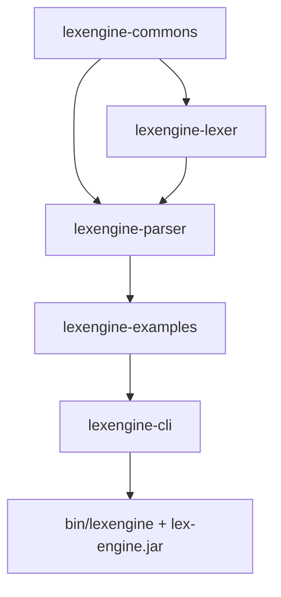
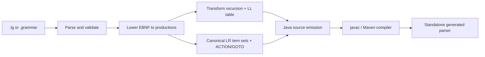

# Architecture and Maven integration

## Modules

| Module | Responsibility |
| --- | --- |
| `lexengine-commons` | Options, resource loading, template rendering, validation, logging and generator errors. |
| `lexengine-lexer` | Regex parsing, alphabet partitioning, NFA/DFA generation, DFA minimization and scanner source generation. |
| `lexengine-parser` | Legacy/combined specification parsing, EBNF lowering, FIRST/FOLLOW, recursion elimination, parser tables and Java emission. |
| `lexengine-examples` | Build-generated parsers/scanner, typed Java consumers, sample specifications and inputs. |
| `lexengine-cli` | Unified command dispatch, executable JAR, launchers and packaged-distribution tests. |

The parent POM declares these modules in dependency order and configures Java 21 compilation, JUnit, Surefire and formatting.



## Grammar generation pipeline



`GrammarSpecParser` selects legacy or combined input. `GrammarV2Parser` reads Java metadata, token definitions and multiline EBNF rules. Both paths use the shared `Grammar` model for algorithms. Epsilon is represented by an empty alternative.

`ParserSource` emits the common runtime, grammar arrays, optional combined text lexer and algorithm-specific members. Its default template is loaded as a classpath resource, including from the executable JAR.

## Standalone lexer pipeline

The DFA path reads `.spec` rules and constructs an alphabet of disjoint inclusive ranges. Regex expressions become NFA fragments. Subset construction computes the DFA using epsilon closures; partition refinement minimizes action-equivalent states while preserving transition behavior.

Source emission writes the transition table, token actions and scanner runtime into a Java template. The table includes reserved state zero and every real DFA state. The generated scanner embeds its character buffer and does not require generator classes at runtime.

The combined `.lg` text lexer uses Java `Pattern` matching instead of this DFA pipeline. Its generated parser accepts a source `String`. The standalone scanner accepts a `Reader` and is connected to a parser with an adapter when needed.

## Build-time example generation

[lexengine-examples/pom.xml](../lexengine-examples/pom.xml) binds two plugins to `generate-sources`:

1. **Maven AntRun** invokes the existing parser and lexer entry points in forked JVMs with the module's compile dependency classpath. A macro selects each specification and parser algorithm. The scanner invocation supplies its class and package names.
2. **Build Helper** adds `target/generated-sources/lexengine/` as a Java source root.

Maven's normal `compile` phase then compiles the generated classes alongside the typed example consumers and companion token/adapter classes. `test` exercises accepted and rejected inputs through those compiled classes. `package` includes their bytecode and input resources in `lexengine-examples`' JAR.

There is no runtime reflection/compilation step in the example runner. Its calls are ordinary Java references to generated classes, so broken generation or Java integration fails the build.

## CLI distribution builder

[lexengine-cli/pom.xml](../lexengine-cli/pom.xml) assembles the distribution during `package`:

1. The JAR plugin packages CLI classes.
2. Shade includes the examples and their transitive generator dependencies in `target/lex-engine.jar`.
3. The manifest declares `org.lexengine.cli.Main` and the project implementation version.
4. AntRun copies the executable JAR and two launcher sources into the configured distribution directory.
5. The POSIX launcher receives mode `755` on Unix systems.

The default directory is the repository's `bin/`, computed relative to the CLI module. `-Dlexengine.distributionDirectory=<absolute-path>` overrides it.

The executable JAR includes generated example classes and the source templates needed for new generation. Obsolete scanner resources from the parser artifact are excluded during shading to avoid colliding with the lexer module's default resources.

The launchers select `$JAVA_HOME/bin/java` or `%JAVA_HOME%\bin\java.exe` when configured, and otherwise invoke `java` from `PATH`. The POSIX launcher verifies the selected runtime is Java 21+. On macOS, a missing or incompatible runtime triggers discovery of an installed JDK 21+ through `/usr/libexec/java_home`. It selects a runtime for that process without modifying the caller's environment. They locate the executable JAR beside the launcher, retain the caller's working directory and forward arguments.

The [POSIX builder](../scripts/build-cli.sh) and [Windows builder](../scripts/build-cli.cmd) are convenience entry points for the same Maven build. They select `lexengine-cli` with `-am`, forward Maven arguments, and finish with `package`. The normal root reactor build also creates the distribution automatically.

## Cleaning and source control

The CLI clean configuration removes only `lexengine`, `lexengine.cmd` and `lex-engine.jar` from the distribution folder. Unrelated files there are preserved. Other module outputs are cleaned through the normal Maven lifecycle.

`bin/` and `target/` outputs are ignored by Git. The tracked inputs are grammars, lexical rules, Java consumers, launchers under `lexengine-cli/src/main/scripts/`, build scripts and POM configuration.

## Verification

```sh
mvn clean verify
```

Unit tests run through Surefire. CLI distribution tests run through Failsafe after packaging and are checked during `verify`.

The tests cover:

- Grammar parsing, EBNF validation, FIRST/FOLLOW and recursion transformation.
- Compiling generated Java in isolated class loaders without generator dependencies.
- All parser algorithms, nullable input, invalid/trailing tokens and table conflicts.
- DFA regex behavior, minimization, state serialization, interval queries and buffer boundaries.
- Typed examples, JSON escapes/numbers, configuration syntax and lexer adapters.
- Executable-JAR versioning, compiled demos and generation using bundled templates.
- Moving the launcher/JAR to a folder with spaces and invoking it from another directory.

The GitHub Actions workflow runs the Maven verification lifecycle on Java 21 and 25. POSIX launchers are exercised by Unix runs; the Windows launcher is provided for Command Prompt use.

## Formatting

Formatting is an explicit operation and does not rewrite sources as a side effect of compilation:

```sh
mvn spotless:apply
```

The parent configuration uses Google Java Format, removes unused imports and applies the repository copyright header.
